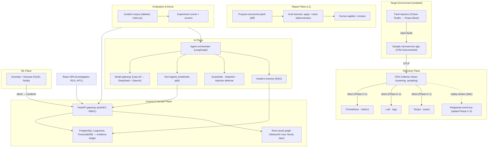

# IncidentAI: An Autonomous Reliability Engineering Platform

**Technical Report** — v0.2 (draft)
Author: _[your name]_
Date: 2026-11-15

---

## Abstract

This report presents the design of **IncidentAI**, a platform for detecting, investigating, reproducing, and repairing failures in distributed applications, with a closed-loop learning mechanism and a reproducible evaluation harness. The system integrates distributed observability, agentic large language models, graph-based root-cause analysis, machine-learning anomaly detection, and evidence-grounded code-repair proposals under strict human oversight. A central design principle is that the platform's Chaos Engineering Laboratory serves as a *ground-truth generator*, enabling an evaluation-driven development methodology rather than subjective demonstrations. We describe the system architecture, the AI engineering strategy, the evaluation methodology, the phased development plan, and the principal technical risks. The work targets an open-source technology stack, using the DeepSeek and OpenAI APIs, routed by role.

---

## 1. Introduction

Modern software systems are distributed, heterogeneous, and failure-prone. When an incident occurs, engineers must correlate signals across logs, metrics, and traces, localize a root cause, and produce a verified fix — a process that is slow, expensive, and increasingly beyond human scale. Large language models (LLMs) offer the possibility of automating substantial portions of this workflow, but naively delegating to an LLM produces confident yet unverified reasoning and unsafe, unverified code changes.

IncidentAI addresses this gap by treating reliability engineering as a *measurable, safety-bounded, agentic* problem. The system's tagline — *Detect. Investigate. Simulate. Repair. Learn.* — defines a closed loop in which every stage is observable, auditable, and evaluable.

### 1.1 Contributions

1. An architecture that composes deterministic telemetry processing, statistical anomaly detection, graph-based correlation, and LLM reasoning, assigning each to the mechanism best suited to it.
2. A safety model for investigation and repair: read-only investigation tools, human-applied repair patches, and mandatory approval.
3. An evaluation methodology in which intentionally injected faults provide labeled ground truth, with a hidden hold-out set to prevent benchmark leakage.
4. An open-source reference implementation plan suitable for a solo engineer.

### 1.2 Scope

The platform comprises three cooperating environments: (i) an **AI Operations Center** for monitoring and investigation; (ii) a **Chaos Engineering Laboratory** for controlled fault injection; and (iii) an **Incident Arena** for human-versus-AI benchmarking. The latter two are treated as a single evaluation system.

---

## 2. Background and Related Work

### 2.1 Observability

The OpenTelemetry project has standardized the collection of logs, metrics, and traces. Log-template clustering (e.g., the Drain algorithm, now available as an OpenTelemetry Collector processor) reduces high-cardinality logs to a tractable set of templates [1]. Correlation across signals remains the central open problem for root-cause analysis.

### 2.2 Agentic AI and orchestration

Agentic systems decompose tasks into tool-using loops. Frameworks such as LangGraph provide stateful, checkpointed orchestration with conditional routing and human-in-the-loop control, which suits incident investigation better than stateless chat or free-form multi-agent conversation [2]. The AutoGen ecosystem, historically influential, has fragmented into multiple successors, motivating a conservative single-framework choice [3].

### 2.3 Autonomous software repair

Current evidence from the SWE-bench family indicates that frontier models resolve a majority of *simplified, single-file* issues but a minority of *realistic multi-file* issues, and performance degrades sharply on private, held-out subsets [4]. The bottleneck is frequently the production of a valid reproduction test rather than the edit itself [5]. These results motivate a reproduce-first, test-driven repair workflow and honest, hold-out-based evaluation rather than inflated success claims.

### 2.4 Retrieval-augmented generation

RAG grounds LLM outputs in retrieved knowledge. Hybrid retrieval (lexical BM25 plus dense embeddings) with reranking and mandatory citation is the standard approach for trustworthy, auditable generation [6].

---

## 3. System Requirements

### 3.1 Functional

- Ingest logs, metrics, and traces from a sample microservice application.
- Detect anomalies and raise incidents.
- Investigate incidents using agentic tool use; produce structured, evidence-backed root-cause reports.
- Retrieve similar historical incidents and relevant documentation.
- Generate candidate code fixes as structured patches; the human applies them, and the evaluation harness verifies them (apply + tests).
- Inject deterministic faults and benchmark human and AI performance.

### 3.2 Non-functional

- **Cost:** tooling is free/open-source; the paid dependencies are the DeepSeek and OpenAI APIs, routed to minimize spend.
- **Safety:** investigation is read-only by default; repair is human-applied (no autonomous code execution) and human-gated.
- **Auditability:** every agent action and hypothesis is traceable to evidence.
- **Evaluability:** all AI behavior is measurable against labeled ground truth.

---

## 4. System Architecture

The architecture is a **modular monolith** with security-driven isolation boundaries. The platform is decomposed into eight cooperating planes.



### 4.1 Component responsibilities

- **Target Environment** runs the instrumented sample application and fault injectors; it is the source of ground truth.
- **Telemetry Plane** normalizes and routes signals. The OpenTelemetry Collector applies log clustering and tail sampling *before* any LLM interaction.
- **Control & Domain Plane** owns the incident lifecycle and the evidence ledger; all agent outputs are persisted here rather than in chat context.
- **AI Plane** is the orchestrator, tool registry, memory, and guardrails. It is stateless in principle; durable state lives in PostgreSQL.
- **ML Plane** runs cheap, always-on statistical models for detection and forecasting; LLMs are invoked to *explain and decide*, not to detect.
- **Repair Plane (L1)** proposes structured patches; the evaluation harness verifies them (apply + tests) deterministically, and the human applies them. No autonomous code execution.
- **Evaluation Plane** is a client of the system, scoring against the labeled corpus.
- **Frontend** splits into Grafana (raw telemetry, reused) and a custom React application (investigation narrative, root-cause graph, approval workflow).

### 4.2 Communication

Telemetry is asynchronous and loss-tolerant; early phases write directly to stores, with a Redpanda replay stream added in Phase 2–3. Control traffic is synchronous REST over FastAPI. Long-running agent workflows use checkpointed state and background task queues. The frontend receives updates via server-sent events.

---

## 5. AI Engineering Design

### 5.1 Division of labor

A foundational principle is the assignment of each concern to the most reliable mechanism:

| Concern | Deterministic | ML | LLM | Orchestration |
|----------|:---:|:---:|:---:|:---:|
| Anomaly detection | | ✓ | | |
| Log templating | ✓ | | | |
| Topology/correlation | ✓ | ✓ | | |
| Forecasting | ✓ | ✓ | | |
| Explanation/narrative | | | ✓ | |
| Hypothesis generation | | | ✓ | |
| Code generation | | | ✓ | |
| State, retries, human gates | | | | ✓ |

### 5.2 The investigation loop

```
detect → triage → evidence collection (read-only tools) →
hypothesis generation (structured) → falsification (critic + checks) →
ranked root-cause report → [remediation] → learn
```

Evidence collection uses **bounded, structured tools** that return typed results rather than raw streams. The LLM reasons over a compressed *incident snapshot* (top anomaly, affected services, key log templates, a trace slice, recent deployments), never over the full telemetry volume.

### 5.3 Tool security

Investigation tools are read-only by default; write tools require escalation. Every tool has an allow-listed schema, bounded time windows, output caps, PII redaction, rate limits, and a full audit trail. All telemetry and retrieved content is treated as untrusted input to mitigate prompt injection.

### 5.4 Multi-agent collaboration

A supervisor coordinates specialists (telemetry analyst, code analyst, verifier, remediation planner) that share a database evidence ledger. Conflicting hypotheses are ranked by evidence weight and subjected to a falsification critic; genuinely ambiguous cases escalate to a human with an explicit statement of what evidence would resolve the disagreement.

### 5.5 Repair (L1: propose, verify, human-applies)

The repair target is **L1**. The agent localizes the fault using code search and embeddings and proposes a **structured patch (a diff)**. The agent does not execute code. The evaluation harness then applies the patch to a clean checkout and runs the reproduction test plus the suite, producing a deterministic pass/fail. The human reviews and applies the final change. Full autonomous execution (**L2**, with a sandbox) is a later option.

### 5.6 Evaluation

Metrics: detection recall and false-positive rate; RCA Top-1 and Top-3 accuracy; hallucination rate (unsupported claims); patch-apply rate; fix success rate (reproduction test passes with no regressions); cost per incident; time-to-diagnosis; tool-call count; and end-to-end success rate. The incident corpus is split into train/dev/hold-out sets, and a hidden set is never used during development, to detect benchmark leakage. Every prompt, tool, or architecture change triggers a re-run of the evaluation suite.

---

## 6. Development Plan

| Phase | Objective | Key deliverable |
|-------|-----------|-----------------|
| 0 | Foundations | Instrumented sample app; Compose; OTel + Drain; Grafana |
| 1 | Detect | Statistical anomaly detection → alerts → incidents; minimal deterministic injector |
| 2 | Investigate | Single agent + read-only tools; structured report; evidence ledger; first score |
| 3 | Remember | Incident memory (RAG) with hybrid retrieval + citations |
| 4 | Orchestrate | Supervisor + specialists; root-cause graph; conflict resolution |
| 5 | Repair | L1: propose structured patch; eval harness verifies (apply + tests); human applies |
| 6 | Evaluate | Chaos Lab formalized as label generator; hold-out eval set; leaderboard |
| 7 | Arena & scale | Human-vs-AI benchmarking; k8s; optional fine-tuning |

The **minimum viable product** is a single vertical slice: *inject → detect → investigate → report → score.* A minimal deterministic injector (ground-truth labels) must exist by Phase 1–2.

---

## 7. Risk Analysis

| Risk | Likelihood | Impact | Mitigation |
|------|:---:|:---:|------------|
| Hallucinated root causes | High | High | Evidence-weighted hypotheses; falsification critic; mandatory citations |
| Repair incorrectness on realistic issues | High | High | Reproduce-first; low expectations; human gate; hold-out benchmark |
| Benchmark leakage | High | Med | Hidden hold-out set never used in development |
| Telemetry volume vs. context window | High | Med | Drain clustering; sampling; bounded tools; incident snapshot |
| Prompt injection via telemetry | Med | High | Untrusted-input policy; schema-validated tools; read/write split |
| Cost blowup of multi-agent loops | Med | Med | Budgets; model routing; cheap-model triage |
| Malicious/broken generated code in the eval harness | Low | Med | Run the harness in an isolated container (no egress, resource caps, unprivileged) |
| Scope creep | High | Med | Modular monolith; strict phase gates; complete workflows over feature count |

Embeddings use OpenAI's `text-embedding-3-small` (DeepSeek exposes no embeddings endpoint); API latency, rate limits, and token cost must also be budgeted for the agent loops. Autonomous repair remains the most demanding area: even frontier models solve only a minority of realistic multi-file issues, which is why the project targets L1 (propose, human-applies) rather than full autonomy. The platform's value is the *safe, verifiable, measurable* repair pipeline and its honest benchmark numbers.

---

## 8. Conclusion and Future Work

IncidentAI is a feasible, portfolio-grade project whose distinguishing feature is not the AI itself but the evaluation-driven, safety-bounded engineering around it. Future work includes escalation to L2 (autonomous sandboxed repair), multi-model consultation for uncertain diagnoses, graph-aware retrieval, preference tuning from collected human feedback, and large-scale deployment on Kubernetes with Chaos Mesh.

---

## References

[1] Honeycomb, "Taming Log Noise With the OpenTelemetry Collector's Drain Processor," 2026. https://www.honeycomb.io/blog/taming-log-noise-with-the-opentelemetry-collector-s-drain-processor

[2] Microsoft Learn, "Compare orchestration frameworks," 2026. https://learn.microsoft.com

[3] AgentMail, "The Best AI Agent Frameworks in 2026," 2026. https://www.agentmail.to/blog/best-ai-agent-frameworks-2026

[4] "SWE-bench Deep Dive — Empirical AI Agent Performance," 2026. https://raw.githubusercontent.com/MohamedAbdallah-14/Wazir/refs/heads/main/docs/research/agent-architecture/swe-bench.md

[5] TDFlow, "Agentic Workflows for Test Driven Development," EACL 2026. https://aclanthology.org/2026.eacl-long.70/

[6] "Chaos engineering tooling landscape," 2026. https://github.com/alirezarezvani/claude-skills

---
